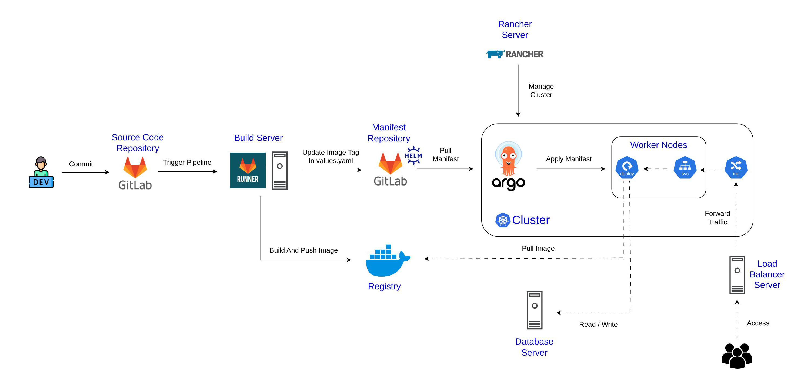

# E-Commerce GitOps & Kubernetes Platform

An end-to-end automated CI/CD and GitOps infrastructure platform built on Kubernetes. This project demonstrates a production-oriented DevOps workflow that decouples Continuous Integration from Continuous Delivery, enforces automated Helm chart validation, and manages declarative cluster state through ArgoCD and Rancher.

---

## Architecture Overview



The platform follows a pull-based GitOps deployment model:

* **Continuous Integration (GitLab CI/CD):** Handles static validation, Helm chart linting, multi-stage Docker image builds, registry publishing, and declarative manifest updates.
* **Continuous Delivery (ArgoCD):** Continuously monitors the Git repository as the single source of truth and reconciles cluster state changes automatically without direct `kubectl` access from the CI runner.

---

## Infrastructure & DevOps Stack

| Domain | Technologies |
| :--- | :--- |
| **Source Control & CI** | Self-Hosted GitLab, GitLab CI/CD, GitLab Runner |
| **Containerization & Registry** | Docker, Nginx (Reverse Proxy / Static Serving), Docker Hub |
| **Container Orchestration** | Kubernetes, Rancher Server |
| **Package Management** | Helm |
| **GitOps & Continuous Delivery** | ArgoCD |
| **Pipeline Automation & Linting** | Python |
| **Traffic Routing & Autoscaling** | Kubernetes Ingress, Horizontal Pod Autoscaler (HPA), Metrics Server |

---

## CI/CD & GitOps Pipeline Workflow

1. **Pipeline Trigger:** Pushing changes to GitLab triggers a multi-stage `.gitlab-ci.yml` pipeline executed by dedicated GitLab Runners.
2. **Automated Linting & Validation:** Custom Python scripts powered by `ruamel.yaml` validate Helm chart syntax, indentation, and schema integrity prior to image builds.
3. **Container Build & Publishing:** Multi-stage Dockerfiles build minimal production images for the `frontend` and `backend` workloads and push immutable, commit-tagged images to Docker Hub.
4. **Declarative Manifest Mutation:** Upon a successful push, an automated CI job updates the image tags in the Helm `values.yaml` file using `ruamel.yaml` and commits the updated configuration back to the repository.
5. **GitOps Reconciliation:** ArgoCD detects the new commit in the target Helm chart path, compares the desired state against the live Kubernetes cluster, and executes a rolling update with zero manual intervention.

---

## Kubernetes & Cluster Operations

* **Parameterized Helm Charts:** Encapsulates Deployments, ClusterIP Services, Ingress rules, ConfigMaps, Secrets, and HPA definitions into reusable, environment-ready templates.
* **Dynamic Workload Autoscaling:** Configures CPU and memory-based Horizontal Pod Autoscaling (HPA) backed by Kubernetes Metrics Server to scale replicas under variable load.
* **Configuration & Secret Separation:** Isolates environment-specific parameters in `ConfigMaps` and sensitive runtime credentials in Kubernetes `Secrets`.
* **Centralized Cluster Management:** Utilizes Rancher Server for cluster lifecycle administration, RBAC enforcement, namespace isolation, and real-time workload observability.

---

## Repository Structure

```text
e-commerce-gitops-kubernetes-platform/
├── .gitlab-ci.yml          # Multi-stage CI pipeline definition
├── app/
│   ├── backend/            # Containerized backend service & multi-stage Dockerfile
│   └── frontend/           # Containerized frontend service, Nginx config & Dockerfile
├── docs/
│   └── image/              # System architecture and pipeline diagrams
├── helm/                   # Helm charts (Deployments, Services, Ingress, HPA, values.yaml)
├── scripts/                # Python automation scripts for YAML linting and image tag updates
└── LICENSE